<!-- DISEÑO B · TERMINAL HACKER — sube la carpeta assets/ a tu repo mikeOz27/mikeOz27 -->
<p align="center">
  
</p>

<p align="center">
  
</p>

<p align="center">
  <a href="https://mikeoz27.github.io/" target="_blank"></a>
  <a href="https://www.linkedin.com/in/michael-martinez-de-la-hoz/" target="_blank"></a>
  <a href="https://x.com/MikeDeLaOzz" target="_blank"></a>
  <a href="https://www.instagram.com/michael_martinez7/" target="_blank"></a>
  
</p>

```console
michael@santa-marta:~$ cat sobre_mi.txt
```
```diff
+ Ingeniero de Sistemas · Universidad del Magdalena
+ FullStack Developer: interfaces en Vue/React/Angular y APIs con Laravel/Node/Spring
+ Trabajando en:  [en qué trabajas ahora]
+ Aprendiendo:    [qué estás aprendiendo]
+ Fortaleza:      resolutivo, divido cada problema en pasos pequeños
+ Fuera del código: fútbol ⚽ · videojuegos 🎮 · anime · música 🎧
- Bugs:           eliminados en cuanto aparecen 🐛🔨
```

```console
michael@santa-marta:~$ ls ./stack --color
```
<p align="center">
  <br/>
  <br/>
  
</p>

```console
michael@santa-marta:~$ ls -la ./proyectos
```
<p align="center">
  <a href="https://github.com/mikeOz27/invoice-crud-angular"></a>
  <a href="https://github.com/mikeOz27/invoice-api-cshart.net"></a>
  <a href="https://github.com/mikeOz27/spring-boot-mysql-crud"></a>
  <a href="https://github.com/mikeOz27/dragon-ball-desk-react"></a>
</p>

```console
michael@santa-marta:~$ ./stats --live
```
<p align="center">
  
  
</p>
<p align="center">
  
</p>
<p align="center">
  
</p>

<p align="center">
  
</p>
